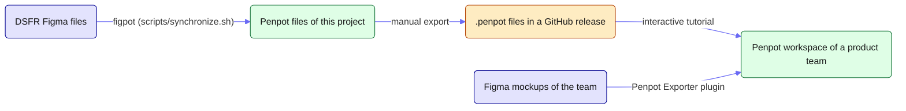

# penpot-dsfr

This repository makes the [DSFR Figma files](https://www.figma.com/@gouvfr) (the French government design system) available on [Penpot](https://penpot.app/), the open-source design tool. Figma files remain the source of truth, so the design system team does not change its daily work, and their Penpot copies serve product teams that either struggle with Figma subscriptions or need to keep their mockups on infrastructures they control.

By default, administrations use the Penpot instance of the SIG (the team managing the DSFR): https://penpot.systeme-de-design.gouv.fr/.


> [!IMPORTANT]
> `penpot-dsfr` is an experiment and the user experience may not be perfect (mainly due to technical limitations). Do not hesitate to share your thoughts by contacting us at [penpot-dsfr@beta.gouv.fr](mailto:penpot-dsfr@beta.gouv.fr).

## How it works



1. **Conversion, done once per DSFR version by us**: [figpot](https://github.com/betagouv/figpot) synchronizes the 5 DSFR Figma files into Penpot files, keeping the links between them. They are exported as `.penpot` files and published in [the releases](https://github.com/betagouv/penpot-dsfr/releases). Product teams never have to convert the DSFR themselves.
2. **Installation, done once per Penpot team**: Penpot cannot share a library across teams, so each team imports the files into its own workspace. Since the files reference each other, they must be imported in order, each one shared as a library before importing the next: since Penpot 2.19, an import links the libraries of the file to the shared files of the team having the same name. The [interactive tutorial](https://betagouv.github.io/penpot-dsfr/) guides users through these steps (it is also opened from [the page proposed to the DSFR documentation](documentation/)).
3. **Transfer of existing mockups, optional**: product teams convert their own Figma files with the official [Penpot Exporter](https://www.figma.com/community/plugin/1219369440655168734/penpot-exporter) Figma plugin, giving it the Penpot addresses of their DSFR libraries so the components stay bound. Their mockups should use the same DSFR version as the one installed: the tutorial asks for it and advises migrating in Figma first, otherwise components with a lost link have to be fixed by hand in Penpot (teams starting from scratch use the installed version).

The files depend on each other in this order (each file can use the previous ones):

```
Pictogrammes ← Fondamentaux ← Composants ← Modèles, Bêta
```

_On Figma, `Pictogrammes` and `Fondamentaux` use each other. To allow importing them one after the other, `Pictogrammes` is converted without any dependency, and the few components of `Composants` used in the presentation pages of `Fondamentaux` are kept as plain shapes._

## Repository layout

| Path                                                                         | Content                                                                                                 |
| ---------------------------------------------------------------------------- | ------------------------------------------------------------------------------------------------------- |
| [`scripts/synchronize.sh`](scripts/synchronize.sh)                           | figpot parameters of each DSFR file (Figma and Penpot identifiers, libraries, exclusions)               |
| [`data/`](data/)                                                             | figpot data: mappings between Figma and Penpot elements (`documents/`), cached Figma images (`medias/`) |
| [`tutorial/`](tutorial/)                                                     | Interactive tutorial installing the DSFR into a Penpot team (static website)                            |
| [`documentation/`](documentation/)                                           | Page written for https://www.systeme-de-design.gouv.fr/, with a local preview                           |
| [`.github/workflows/sync.yml`](.github/workflows/sync.yml)                   | Synchronization of the DSFR files (manual trigger)                                                      |
| [`.github/workflows/documentation.yml`](.github/workflows/documentation.yml) | Checks, builds and GitHub Pages deployment of the tutorial and the documentation preview                |

## Using the DSFR on Penpot

Follow [the interactive tutorial](https://betagouv.github.io/penpot-dsfr/) (in French): it guides you through the preparation of your workspace (Marianne font, project, new render engine), imports the files one by one with their links, then explains how to transfer your Figma mockups.

The tutorial only links to the release files and explains each step, so importing them without it works the same, as long as the order is respected, each file is shared as a library before importing the next, and files are not renamed (Penpot matches the libraries by name).

## Synchronizing the DSFR files

This part is for maintainers converting a new DSFR version.

### Prerequisites

- **[figpot](https://github.com/betagouv/figpot)**: `scripts/synchronize.sh` runs it with `npx`, the `FIGPOT` variable allows using another command (a local checkout for example)
- **Access tokens** (see the figpot documentation): `FIGMA_ACCESS_TOKEN`, `PENPOT_ACCESS_TOKEN`, and `PENPOT_BASE_URL` for an instance other than design.penpot.app (e.g. `https://penpot.systeme-de-design.gouv.fr`)
- **Penpot credentials** for the hydration (see below): `PENPOT_USER_EMAIL`, `PENPOT_USER_PASSWORD`
- **Around 8 GB of RAM** for `Composants`: Node.js limits its memory by default, raise it with `NODE_OPTIONS=--max-old-space-size=8192` (the CI uses 12 GB)

### Prepare the Figma files

The DSFR files on https://www.figma.com/@gouvfr belong to [the SIG](https://www.info.gouv.fr/organisation/service-d-information-du-gouvernement-sig). figpot needs a Figma token able to read their styles and components, so we work on our own copies:

1. Duplicate the DSFR files of the version to convert into our Figma workspace
2. In each file, open the libraries panel and remove the libraries that are not used
3. Swap the libraries still pointing to the original files or to older versions with our copies (tick "for all pages"), and repeat until nothing is left
4. Old references can still hide in hidden layers of instances (the Figma interface does not list them, figpot does): fix them in Figma, for example with a script using `figma.skipInvisibleInstanceChildren = false`
5. Update the Figma file keys in `scripts/synchronize.sh`

_`Composants` v1.14 has a `default-text-success` defect to fix by hand._

### Synchronize

Create empty Penpot files for the new version, put their identifiers in `scripts/synchronize.sh`, then synchronize the files in the dependency order:

```sh
./scripts/synchronize.sh pictogrammes
./scripts/synchronize.sh fondamentaux
./scripts/synchronize.sh composants
./scripts/synchronize.sh modeles
./scripts/synchronize.sh beta
```

- Each update makes Penpot load and check the whole file, which slows down as the file grows. For a first push of a big file, add `--no-server-validation`, then run the synchronization again (`--use-cached-figma-data` avoids fetching Figma again): it must report no difference. The figpot documentation explains how to validate a whole file afterwards
- Starting from fresh Penpot files is preferred, changing many identifiers in an existing big file doubles its size during the push
- The presentation frames of `Composants` are excluded (about half of the file), otherwise the file is too big to be updated through the API
- At the end, figpot "hydrates" each file: it opens it in a browser so Penpot computes the text layouts that only a browser can compute. It needs a display (`xvfb-run -a ./scripts/synchronize.sh ...` on a server). `--no-hydrate` skips it, but viewers through a share link would see overlapping texts until someone edits the file

### Publish a release

The files are synchronized on the SIG instance (https://penpot.systeme-de-design.gouv.fr), then exported one by one from its interface, in the dependency order: `Pictogrammes`, `Fondamentaux`, `Composants`, `Modèles`, then `Bêta`.

1. From the dashboard, open the menu of a file and choose `Export Penpot file`
2. Pick the 4th option, `Link matching libraries on import`: the libraries are not embedded nor detached, the exported file only keeps their names, so Penpot links them at import to the shared files of the destination team having the same names. This option is only displayed when the instance enables the `export-link-later` flag (not the case of the SIG instance for now)
3. Attach the 5 files to a new GitHub release (asset names containing `pictogramme`, `fondamentaux`, `composants`, `modeles` and `beta` are recognized), and do not rename the Penpot files since their names are the ones matched at import

Then run the `Documentation` GitHub Actions workflow manually (`Actions` tab, `Run workflow`, optionally with the release tag) so the tutorial proposes the new files. No text has to be changed in the tutorial: it reads the DSFR version from the names of the release files.

### Continuous integration

- `.github/workflows/sync.yml` synchronizes all the files. It is triggered manually and needs the repository secrets `FIGMA_ACCESS_TOKEN`, `PENPOT_ACCESS_TOKEN`, `PENPOT_USER_EMAIL` and `PENPOT_USER_PASSWORD` (not environment ones). The mappings are committed back into `data/` (`--sync-mapping-with-git`)
- `.github/workflows/documentation.yml` checks and builds the tutorial, its Storybook and the documentation preview in parallel jobs, then deploys them as a static website on GitHub Pages (see [`tutorial/README.md`](tutorial/README.md#deployment))

## Frequently Asked Questions

### Why are there missing elements compared to Figma?

All the components are there, in light and dark themes. Only the example boards of `Composants` (each component presented in context, desktop and mobile) were removed: they were about half of the file, and Penpot handles big files less efficiently than Figma (it refuses to update files of a few hundred thousand elements through its API, `Composants` having around 500,000 on Figma). To discover the DSFR, prefer [its documentation](https://www.systeme-de-design.gouv.fr/) or [its Figma files](https://www.figma.com/@gouvfr) (readable without a Figma subscription).

### Why do DSFR components miss some properties?

Penpot supports variants, but not yet the other kinds of Figma component properties: a boolean to hide an element across all variants, a text to edit from the properties panel, or an instance to swap. Texts are edited from the canvas, and nested icons are changed with "Swap component".

### Why is Penpot laggy?

Enable the new render engine (`Your account`, `Settings`, `WebGL rendering`), prefer Chrome or Chromium, avoid opening `Composants` and `Fondamentaux` directly (use them as libraries from your own files), and avoid having too many tabs open.

### What does Penpot miss for a more faithful conversion?

Penpot covers what designing with the DSFR needs, but a few Figma features have no equivalent yet, so the converted files differ:

- Truncating a text with an ellipsis: https://github.com/penpot/penpot/issues/4426
- A text in a "hug" parent with a "fill" width wraps differently than in Figma: https://github.com/penpot/penpot/discussions/7163
- Relinking existing copies to another library, needed to move mockups to a new DSFR version
- Design tokens scoped per component instance, used by the DSFR v2

## Contribution or sponsoring

If you are willing to help, please have a look at the reported issues https://github.com/betagouv/penpot-dsfr/issues. I will do my best to address your work, but keep in mind the maintenance of this project is in my spare time or on the time of other contributors.

There is currently no public organization sponsor for this port. But if your entity is willing to take over `penpot-dsfr`, please contact us at [penpot-dsfr@beta.gouv.fr](mailto:penpot-dsfr@beta.gouv.fr).
