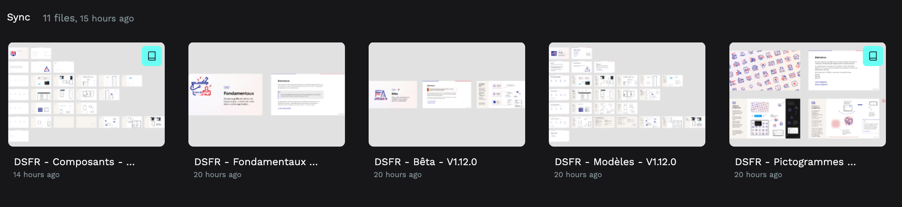
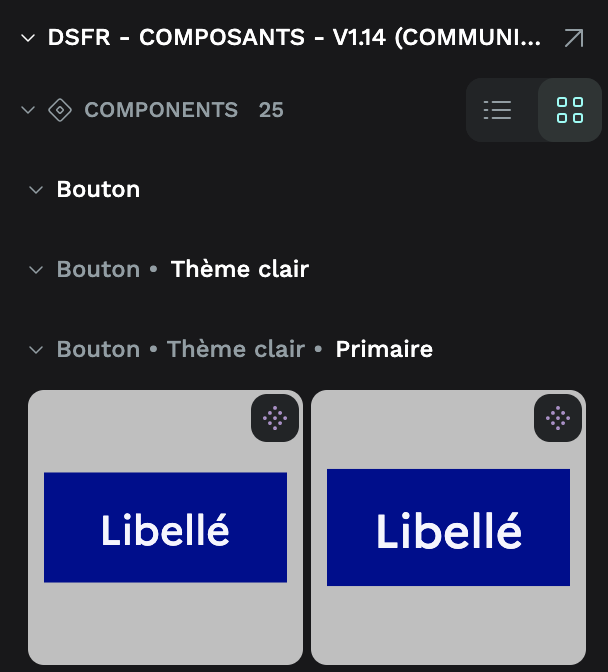

# Concevoir avec Penpot

[Penpot](https://penpot.app/) est un outil de conception d’interfaces libre et open source. Il peut être utilisé sur [design.penpot.app](https://design.penpot.app/) ou hébergé par votre administration pour garder la maîtrise de vos maquettes.

Les fichiers Figma du DSFR restent la référence. Ils sont convertis automatiquement pour Penpot et publiés à chaque nouvelle version sur [le dépôt penpot-dsfr](https://github.com/betagouv/penpot-dsfr/releases).

## Pourquoi utiliser Penpot ?

- **Pour une équipe sans licence Figma** : Penpot peut être utilisé gratuitement, en ligne ou sur votre propre instance.
- **Pour des maquettes sensibles** : une instance Penpot peut être hébergée sur votre propre infrastructure.
- **Pour les échanges avec les équipes de développement** : Penpot s’appuie sur les standards du web (SVG, CSS, flexbox, grid) et fournit le code associé aux éléments.

## Installer le DSFR dans votre espace Penpot

Penpot ne permet pas encore de partager une bibliothèque d’une équipe à une autre. Les fichiers du DSFR doivent donc être importés dans votre propre équipe, une seule fois : toutes les personnes de l’équipe en profitent ensuite.

Comme les fichiers dépendent les uns des autres, ils doivent être importés dans un ordre précis, en reliant chacun d’eux à ceux déjà importés. Le parcours interactif s’en charge pour vous : il prépare chaque fichier directement dans votre navigateur avant que vous ne l’importiez.

::dsfr-doc-iframe-modal[Lancer le parcours d’installation]{src="https://betagouv.github.io/penpot-dsfr/" title="Installer le DSFR sur Penpot"}

Le parcours se déroule en quelques étapes :

1. **Préparer votre espace** : ajouter la police Marianne à votre équipe et créer un projet dédié.
2. **Importer les bibliothèques essentielles** dans cet ordre : _Pictogrammes_, _Fondamentaux_ puis _Composants_. Après chaque import, vous indiquez l’adresse du fichier dans Penpot pour que le suivant y soit relié.
3. **Importer les fichiers complémentaires** si vous le souhaitez : _Modèles_ et _Bêta_.
4. **Transférer vos maquettes Figma existantes** si vous en avez, à l’aide du plugin _Penpot Exporter_.

### Utiliser le DSFR dans un fichier

1. Ouvrez le fichier de votre service dans Penpot.
2. Dans l’onglet **Ressources** (_Assets_), cliquez sur **Bibliothèques** (_Libraries_).
3. Ajoutez les bibliothèques _Composants_, _Fondamentaux_ et _Pictogrammes_.
4. Recherchez un composant, par exemple `bouton`, et glissez-le dans votre maquette.

::::dsfr-doc-guidelines

:::dsfr-doc-guideline[✅ À faire]{col=6 valid=true}

Utiliser les fichiers _Composants_ et _Fondamentaux_ comme bibliothèques depuis vos propres fichiers.

:::

:::dsfr-doc-guideline[❌ À ne pas faire]{col=6 valid=false}

Ouvrir directement les fichiers _Composants_ ou _Fondamentaux_ pour y concevoir vos maquettes : ils sont volumineux et ralentiraient Penpot.

:::

::::

## Transférer des maquettes depuis Figma

Le plugin Figma [Penpot Exporter](https://www.figma.com/community/plugin/1219369440655168734/penpot-exporter) convertit un fichier Figma en fichier Penpot. Lorsque le plugin détecte des composants DSFR, indiquez-lui l’adresse des bibliothèques DSFR de votre espace Penpot : les composants resteront reliés au DSFR une fois dans Penpot.

Vos maquettes doivent utiliser **la même version du DSFR que celle installée dans Penpot** : seules les versions publiées sur le dépôt penpot-dsfr sont converties. Si vos maquettes reposent sur une version antérieure, mettez-les d’abord à jour dans Figma en suivant la procédure officielle de mise à jour des bibliothèques DSFR, puis transférez-les. Un projet qui démarre directement sur Penpot n’est pas concerné.

Le parcours interactif vérifie ce point avec vous, puis rappelle ces adresses en fin d’installation, prêtes à être copiées.

## Limites connues

Penpot est moins performant que Figma sur les très gros fichiers. Pour rester utilisables, les fichiers convertis ont été allégés :

- **Le thème sombre a été retiré** : les maquettes de l’administration sont en très grande majorité réalisées en thème clair.
- **Les planches de présentation des composants en contexte ont été retirées** : elles contenaient trop d’éléments.
- **Certaines propriétés de composants ne sont pas disponibles** : Penpot ne gère pas encore l’affichage conditionnel d’un élément pour toutes les variantes, ni la modification d’un texte depuis le panneau de propriétés. Le texte se modifie directement dans la maquette.

Pour découvrir le DSFR en détail, consultez la documentation des composants sur ce site ou [les fichiers Figma du DSFR](https://www.figma.com/@gouvfr), consultables sans abonnement.

## Questions fréquentes

### Pourquoi Penpot est-il parfois lent ?

Préférez un navigateur basé sur Chromium (Chrome, Edge…), limitez le nombre d’onglets ouverts et utilisez les fichiers du DSFR comme bibliothèques plutôt que de les ouvrir. Penpot prépare un nouveau moteur de rendu qui devrait améliorer ces performances.

### Les composants sont-ils nommés comme dans le code ?

Les composants reprennent les noms des fichiers Figma, en français : « En-tête » (_Header_), « Pied de page » (_Footer_), « Bouton »…

### Comment mettre à jour le DSFR dans mon espace ?

À chaque nouvelle version, relancez le parcours d’installation dans un nouveau projet (par exemple `DSFR v1.15`), puis remplacez les bibliothèques connectées dans vos fichiers.

### À qui signaler un problème ?

Cette conversion est une expérimentation portée par [beta.gouv.fr](https://beta.gouv.fr/). Écrivez à [penpot-dsfr@beta.gouv.fr](mailto:penpot-dsfr@beta.gouv.fr) ou ouvrez un ticket sur [le dépôt penpot-dsfr](https://github.com/betagouv/penpot-dsfr/issues).
