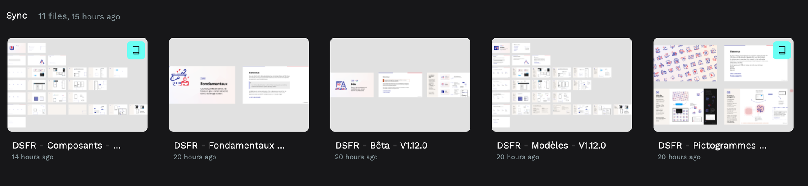
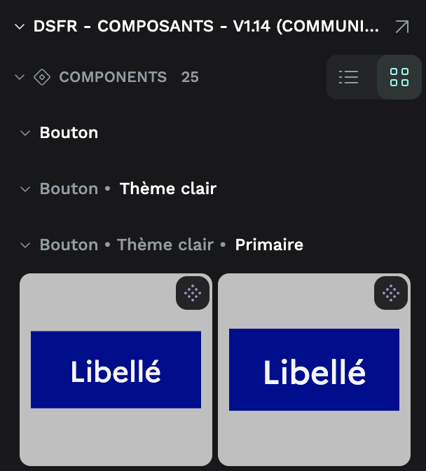
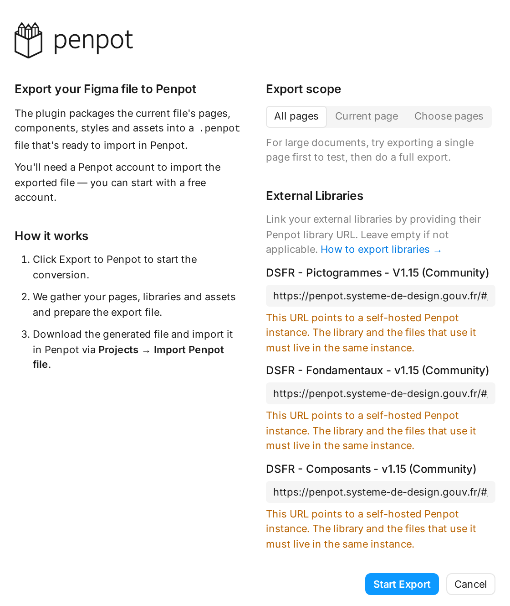

# Concevoir avec Penpot

[Penpot](https://penpot.app/) est un outil de conception d’interfaces libre et open source, alternative à Figma. Le Service d’information du Gouvernement (SIG), qui gère le Système de Design de l’État, propose [une instance Penpot](https://penpot.systeme-de-design.gouv.fr/) aux administrations. Penpot peut aussi être hébergé par votre administration pour garder la maîtrise de vos maquettes.

Les fichiers Figma du DSFR restent la référence. Ils sont convertis automatiquement pour Penpot et publiés à chaque nouvelle version sur [le dépôt penpot-dsfr](https://github.com/betagouv/penpot-dsfr/releases).

## Penpot en quelques mots

Penpot est un outil de conception et de prototypage d’interfaces, alternative libre à Figma et proche de lui dans son usage : pages, calques, composants et variantes, bibliothèques partagées, styles et tokens, mise en page flexible (_flexbox_ et _grid_), prototypes interactifs et commentaires.

- **Libre et open source** : son code est publié sous licence [MPL 2.0](https://github.com/penpot/penpot), développé par l’entreprise Kaleidos et une communauté de contributeurs.
- **Dans le navigateur** : aucune installation n’est nécessaire sur votre poste, et plusieurs personnes peuvent travailler en même temps sur un fichier.
- **Installable par votre administration** : Penpot peut être [auto-hébergé](https://help.penpot.app/technical-guide/getting-started/) sur les serveurs de votre administration, pour que les maquettes ne quittent jamais votre infrastructure.
- **Proche du code** : Penpot décrit les éléments avec les standards du web (SVG, CSS) et affiche le code correspondant, ce qui facilite le passage aux équipes de développement.

## Pourquoi utiliser Penpot ?

- **Pour une équipe sans licence Figma** : Penpot peut être utilisé gratuitement, en ligne ou sur votre propre instance.
- **Pour des maquettes sensibles** : une instance Penpot peut être hébergée sur votre propre infrastructure.
- **Pour les échanges avec les équipes de développement** : Penpot s’appuie sur les standards du web (SVG, CSS, flexbox, grid) et fournit le code associé aux éléments.

### Quelle instance Penpot choisir ?

- **[L’instance du SIG](https://penpot.systeme-de-design.gouv.fr/)**, qui gère le Système de Design de l’État : c’est l’instance proposée par défaut aux administrations.
- **L’instance interne de votre administration**, si elle en dispose : utilisez-la en priorité.
- **Une instance installée sur votre propre infrastructure**, si vos maquettes sont très confidentielles.

L’instance publique [design.penpot.app](https://design.penpot.app/) de l’éditeur de Penpot n’est pas destinée aux maquettes de l’administration, réservez-la à des cas particuliers.

Les fichiers Figma du DSFR restent la référence : la conversion va de Figma vers Penpot uniquement, et ce que vous modifiez dans Penpot ne revient pas dans Figma.

## Installer le DSFR dans votre espace Penpot

Penpot ne permet pas encore de partager une bibliothèque d’une équipe à une autre. Les fichiers du DSFR doivent donc être importés dans votre propre équipe, une seule fois : toutes les personnes de l’équipe en profitent ensuite.

Comme les fichiers dépendent les uns des autres, ils doivent être importés dans un ordre précis, chacun étant partagé comme bibliothèque avant d’importer le suivant : Penpot relie alors automatiquement chaque nouveau fichier à ceux déjà importés, en les retrouvant par leur nom. Votre instance doit pour cela être en version 2.19 ou plus récente. Le parcours interactif vous guide pas à pas.

::dsfr-doc-iframe-modal[Lancer le parcours d’installation]{src="https://betagouv.github.io/penpot-dsfr/" title="Installer le DSFR sur Penpot"}

Le parcours commence par vous demander si vous partez de zéro ou si vous avez des maquettes Figma à transférer, puis se déroule en quelques étapes :

1. **Préparer votre espace** : ajouter la police Marianne à votre équipe, créer un projet dédié et activer le nouveau moteur de rendu de Penpot.
2. **Importer les bibliothèques essentielles**, une à une et dans cet ordre : _Pictogrammes_, _Fondamentaux_ puis _Composants_. Après chaque import, vous partagez le fichier comme bibliothèque pour que le suivant y soit relié. Ne renommez pas les fichiers importés.
3. **Importer les fichiers complémentaires** si vous le souhaitez : _Modèles_ et _Bêta_.
4. **Transférer vos maquettes Figma existantes** si vous en avez, à l’aide du plugin _Penpot Exporter_.

### Activer le nouveau moteur de rendu

Le nouveau moteur de rendu de Penpot est bien plus fluide sur les fichiers volumineux du DSFR, et nécessaire pour afficher certains éléments, comme les bordures d’un seul côté des champs de formulaire. Depuis le tableau de bord de votre instance, ouvrez le menu de votre profil puis **Votre compte**, et activez le **Rendu WebGL** dans la section **Configuration**. Ce réglage est propre à chaque personne de l’équipe.

### Utiliser le DSFR dans un fichier

1. Ouvrez le fichier de votre service dans Penpot.
2. Dans l’onglet **Ressources**, cliquez sur **Bibliothèques**.
3. Ajoutez les bibliothèques _Composants_, _Fondamentaux_ et _Pictogrammes_.
4. Recherchez un composant, par exemple `bouton`, et glissez-le dans votre maquette.

Quelques gestes utiles :

- **Modifier le texte d’un composant** (le libellé d’un bouton…) : double-cliquez dessus dans la maquette.
- **Changer l’icône d’un bouton** : sélectionnez l’icône à l’intérieur du bouton dans le panneau des calques, puis utilisez **Échanger composant** et choisissez une autre icône de _Fondamentaux_. Inutile de détacher le bouton.

::::dsfr-doc-guidelines

:::dsfr-doc-guideline[✅ À faire]{col=6 valid=true}

Utiliser les fichiers _Composants_ et _Fondamentaux_ comme bibliothèques depuis vos propres fichiers.

:::

:::dsfr-doc-guideline[❌ À ne pas faire]{col=6 valid=false}

Ouvrir directement les fichiers _Composants_ ou _Fondamentaux_ pour y concevoir vos maquettes : ils sont volumineux et ralentiraient Penpot.

:::

::::

## Transférer des maquettes depuis Figma

Le plugin Figma [Penpot Exporter](https://www.figma.com/community/plugin/1219369440655168734/penpot-exporter) convertit un fichier Figma en fichier Penpot. Lorsque le plugin détecte des bibliothèques DSFR, indiquez-lui l’adresse de chacune dans votre espace Penpot (ouvrez le fichier dans Penpot et copiez l’adresse de la page) : les composants resteront reliés au DSFR une fois dans Penpot.

La conversion est réalisée par le plugin dans Figma, sur votre poste, et vous importez vous-même le fichier obtenu. Ce fonctionnement dépend toutefois du code réellement publié : pour des maquettes très sensibles, n’hésitez pas à le vérifier, [son code source](https://github.com/penpot/penpot-exporter-figma-plugin) étant ouvert.

Idéalement, vos maquettes utilisent **la même version du DSFR que celle installée dans Penpot**, seule la dernière version étant convertie. Si elles reposent sur une version antérieure, deux possibilités :

- les mettre d’abord à jour dans Figma en suivant la procédure officielle de mise à jour des bibliothèques DSFR, puis les transférer ;
- les transférer telles quelles, puis vérifier dans Penpot les composants qui auraient perdu leur lien ou changé d’apparence, et les remplacer à la main (**Échanger composant**).

Un projet qui démarre directement sur Penpot n’est pas concerné : il utilise la version installée.

Avant l’export, vérifiez dans le panneau **Bibliothèques** de Figma qu’aucune bibliothèque n’est manquante ou d’une autre version. Pour les fichiers volumineux, préférez l’application Figma pour ordinateur et n’exportez que les pages utiles.

Si vos maquettes utilisent aussi vos propres bibliothèques Figma (composants maison, fichiers partagés par une autre équipe…), elles apparaissent également dans la section **External Libraries** du plugin. Pour conserver le lien, elles doivent déjà être dans votre espace Penpot : transférez vos fichiers dans le même ordre que ceux du DSFR, en commençant par ceux qui n’utilisent aucune autre de vos bibliothèques, ajoutez-les en tant que bibliothèques partagées une fois importés, puis passez aux fichiers qui les utilisent, jusqu’à vos maquettes finales.

Le parcours interactif vous demande la version de vos maquettes dès le début et vous rappelle ces vérifications.

## Limites connues

Penpot est moins performant que Figma sur les très gros fichiers. Pour rester utilisables, les fichiers convertis ont été allégés :

- **Le fichier _Composants_ ne contient pas les planches d’exemples** présentant chaque composant en contexte (desktop et mobile, thèmes clair et sombre) : elles représentaient la moitié du fichier. Il diffère donc du fichier Figma, mais tous les composants, en thème clair comme en thème sombre, sont présents : votre usage n’est normalement pas affecté.
- **Certaines propriétés de composants ne sont pas disponibles** : Penpot ne gère pas encore l’affichage conditionnel d’un élément pour toutes les variantes, ni la modification d’un texte depuis le panneau de propriétés. Le texte se modifie directement dans la maquette.
- **Les textes peuvent différer légèrement de Figma** : un texte peut passer sur une ligne de plus, et Penpot ne sait pas encore tronquer un texte trop long avec des points de suspension.

Pour découvrir le DSFR en détail, consultez la documentation des composants sur ce site ou [les fichiers Figma du DSFR](https://www.figma.com/@gouvfr), consultables sans abonnement.

## Questions fréquentes

### Pourquoi Penpot est-il parfois lent ?

Activez le nouveau moteur de rendu (**Votre compte**, **Configuration**, **Rendu WebGL**), préférez un navigateur basé sur Chromium (Chrome, Edge…), limitez le nombre d’onglets ouverts et utilisez les fichiers du DSFR comme bibliothèques plutôt que de les ouvrir.

### Les composants sont-ils nommés comme dans le code ?

Les composants reprennent les noms des fichiers Figma, en français : « En-tête » (_Header_), « Pied de page » (_Footer_), « Bouton »…

### Comment mettre à jour le DSFR dans mon espace ?

Ce n’est pas encore simple. Installer une nouvelle version dans un nouveau projet (par exemple `DSFR v1.16`) fonctionne, mais Penpot ne permet pas encore de remplacer facilement une bibliothèque par une autre dans des fichiers existants. Cette étape reste à éprouver et sera documentée au fil des évolutions de Penpot.

### À qui signaler un problème ?

Cette conversion est une expérimentation portée par [beta.gouv.fr](https://beta.gouv.fr/). Écrivez à [penpot-dsfr@beta.gouv.fr](mailto:penpot-dsfr@beta.gouv.fr) ou ouvrez un ticket sur [le dépôt penpot-dsfr](https://github.com/betagouv/penpot-dsfr/issues).
